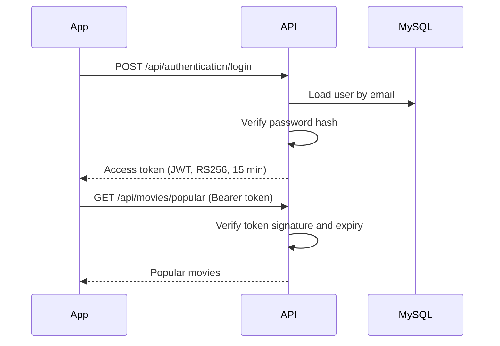

# Movie Roulette API

[](https://github.com/ChristophVorer/movie-roulette-api/actions/workflows/ci.yml)

Spring Boot REST API for a movie discovery app, featuring JWT authentication and TMDB integration. It serves as the
backend for the [Movie Roulette App](https://github.com/ChristophVorer/movie-roulette-app).

> **Status:** in active development

## Features

- User registration and login with JWT-based authentication
- Popular movies fetched from [TMDB](https://www.themoviedb.org/)
- Database schema managed with Flyway migrations
- Consistent error responses following RFC 9457 (Problem Details), including field-level validation errors

## API

| Method | Endpoint                       | Auth         | Description                                   |
|--------|--------------------------------|--------------|-----------------------------------------------|
| `POST` | `/api/authentication/register` | –            | Create an account and receive an access token |
| `POST` | `/api/authentication/login`    | –            | Log in and receive an access token            |
| `GET`  | `/api/movies/popular`          | Bearer token | Popular movies from TMDB                      |
| `GET`  | `/api/movies/{movieId}`        | Bearer token | Details of a single movie from TMDB           |

All other endpoints require a valid access token in the `Authorization: Bearer <token>` header.

Example error response for invalid input:

```json
{
  "title": "Validierungsfehler",
  "status": 400,
  "detail": "Die übermittelten Daten sind ungültig.",
  "validationErrors": [
    {
      "field": "email",
      "message": "Die E-Mail-Adresse ist ungültig."
    }
  ]
}
```

## Tech stack

- **Java 25**, **Spring Boot 4** (Web MVC, Security, OAuth2 Resource Server, Data JPA, Validation)
- **MySQL 8.4** with **Flyway** migrations
- **Spring `RestClient`** for the TMDB integration, **Caffeine** for caching
- **JUnit 5**, **Spring Boot Test**, **Testcontainers**
- **Gradle**, **Docker Compose**, **GitHub Actions**, **Dependabot**

## Getting started

### Prerequisites

- Java 25
- Docker (for the local MySQL database)
- A [TMDB API read access token](https://developer.themoviedb.org/docs/getting-started)

### Run locally

```bash
git clone https://github.com/ChristophVorer/movie-roulette-api.git
cd movie-roulette-api
cp .env.example .env   # then add your TMDB access token
./gradlew bootRun
```

Spring Boot's Docker Compose support starts the MySQL container from `compose.yaml` automatically. Flyway applies all
migrations on startup, and the API is available at `http://localhost:8080`.

### Run tests

```bash
./gradlew test
```

Docker must be running, since integration tests start a real MySQL container.

## Architecture

The code is organised by feature rather than by technical layer, with external systems kept separate from the
application's own domain:

```
de.vorer.movieroulette
├── authentication     # register/login endpoints, request/response DTOs
├── security           # JWT creation, Spring Security configuration
├── user               # user entity, repository and service
└── integration
    └── tmdb           # TMDB client, DTOs and error mapping
```

### Authentication flow



## Design decisions

**Flyway as the single source of truth for the schema.**
Hibernate only validates the schema (`ddl-auto=validate`) and never changes it. Every schema change is a versioned,
reviewable migration, and mismatches between entities and database fail fast on startup.

**JWT with Spring Security's OAuth2 Resource Server.**
Tokens are signed with RS256 and validated by Spring Security's built-in resource server support instead of a
hand-written filter. The token contains the user id as subject plus username and email, so authenticated requests need
no database lookup.

**In-memory signing key (for now).**
The RSA key pair is generated at startup, so no keys are stored in the repository. The trade-off: tokens become invalid
after a restart, and multiple instances cannot share tokens. Loading the key from configuration is planned before any
deployment.

**Passwords hashed with a delegating encoder.**
`PasswordEncoderFactories.createDelegatingPasswordEncoder()` stores the algorithm alongside each hash, so the hashing
algorithm can be upgraded later without invalidating existing passwords.

**Uniform login error.**
Unknown email and wrong password return the same error, so the API does not reveal which email addresses are registered.

**TMDB isolated behind its own client.**
All TMDB communication goes through `TmdbClient` in the `integration` package. TMDB-specific DTOs stay there, and HTTP
errors as well as network failures are translated into a dedicated `TmdbException`. The rest of the application never
depends on TMDB's response format or on `RestClient` details, so the provider could be replaced or mocked without
touching business code.

**Caching TMDB data.**
Data that rarely changes, such as TMDB genres, is cached with Caffeine for 24 hours to reduce latency and stay within
TMDB rate limits. All TMDB requests use German localisation (`de-DE`).

## Testing

- **Integration tests** run against MySQL 8.4 via Testcontainers, the same version as production. An in-memory database
  like H2 was deliberately avoided: it does not support all MySQL syntax used in the migrations and would hide real
  issues.
- **Repository tests** use `@DataJpaTest` slices with the same container setup.
- **Test isolation:** the database is reset before each integration test. Tests deliberately do not use `@Transactional`
  rollbacks, so they exercise real commits and constraint checks just like in production.
- A dedicated `test` profile only overrides what tests need (e.g. a dummy TMDB token) on top of the real configuration.

## CI

Every pull request and push to `main` runs the full build and test suite on GitHub Actions, including the Testcontainers
integration tests. Merging into `main` requires a green build. Dependabot keeps dependencies and GitHub Actions up to
date.

## Roadmap

- More movie lists from TMDB beyond popular movies (e.g. top rated, upcoming, now playing)
- Watchlist to save movies for later
- Random movie suggestions by genre
- Refresh tokens
- Load the JWT signing key from configuration
- OpenAPI documentation

## License

All rights reserved. See [LICENSE](LICENSE) for details.